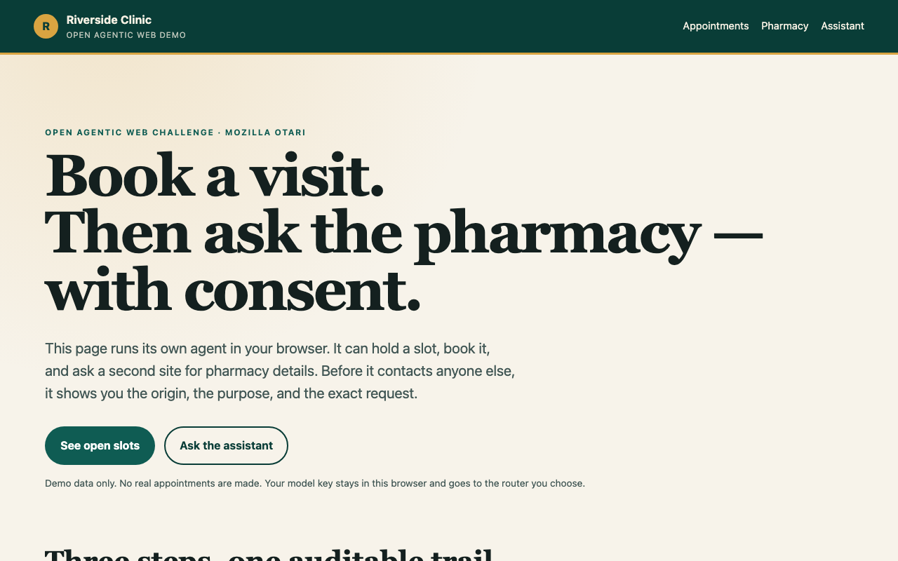

# Care Relay

[](https://github.com/pham-canh/care-relay/actions/workflows/test.yml)

Two agentic websites, one visible consent boundary.



Care Relay is an entry for the [Open Agentic Web Challenge](https://cognizant-agenticweb.devpost.com/), built on the MVP Profile 0.2 and Mozilla's [Otari](https://otari.ai/) router. It is a working pair of static sites:

- **Riverside Clinic** (`127.0.0.1:8080`) is the caller. Its network has a front agent and a `scheduling_agent` specialist that reads appointments, holds a slot, and books it after the visitor confirms.
- **Linden Pharmacy** (`localhost:8081`) is a separate origin. Its assistant knows its services, hours, delivery policy, and refill intake.
- The clinic's assistant can hand a question to the pharmacy. **Before any request reaches the pharmacy origin, the visitor sees the exact origin and request and must allow it.** Nothing is fetched on page load.

The two hostnames are deliberate: `127.0.0.1` and `localhost` are different origins, so the demo exercises the real cross-origin path on one machine.

## Why this is a cross-site problem

An agent that can use other sites is useful only if the user can tell when it crosses a boundary. Care Relay makes that boundary the product:

- The hand-off is a tool call with a natural-language request. The runtime pauses and renders a consent card naming `localhost:8081`, the purpose, and the request text.
- Declining cancels the tool call. The peer manifest, network, and actions are never fetched.
- Allowing fetches only the peer's public artifacts. The peer runs in the caller's browser with the caller's router. It never receives the chat history, the page state, the booking name, or the API key.
- Irreversible writes stay on their owning page. Booking and refill both have their own confirmation dialog and a stale-version check.


## Run it locally

Requirements: Node.js 22+ and an OpenAI-compatible model endpoint that supports tool calls. The default router is Otari's hosted endpoint.

```bash
npm test

# terminal 1
npm run serve:caller

# terminal 2
npm run serve:peer
```

Open <http://127.0.0.1:8080/>. In **AI model settings**, choose **Otari (Mozilla)** and paste a `tk-...` key, or choose another provider and enter its key and model. The key is stored in this browser and sent only to the router you choose.

Try the cross-site path:

1. Ask: *“Can you ask Linden Pharmacy whether they deliver?”*
2. The assistant calls the `pharmacy` tool. A consent card appears before any peer request.
3. Press **Decline** once: the answer stops, and the pharmacy origin was never contacted.
4. Ask again and press **Allow**: the clinic loads the pharmacy's manifest and network, runs it locally, and summarizes the reply.

The manual pages work without a key, so the demo never depends on a provider being available.

## How it works

```
Browser tab, caller origin 127.0.0.1:8080
  index.html
    -> site.js / AssistantMount
    -> runtime boot
    -> agent-manifest.json
    -> riverside_clinic.network.json
    -> site-actions.js  (get_clinic_state, select_slot, book_slot)
  model call -> Otari /api/v1/chat/completions
  tool "pharmacy"
    -> consent card (origin, purpose, exact request)
    -> fetch http://localhost:8081/agent-manifest.json
    -> fetch pharmacy network + links
    -> run the peer network locally with the same router
    -> peer answer returns as a tool result
```

| Path | What it publishes |
| --- | --- |
| `site/agent-manifest.json` | Brand, network, Otari router, `allowed_peers`, closed peer policy, actions, theme, deployment |
| `site/riverside_clinic.network.json` | Resolved Neuro SAN network: front agent, instructions, schemas, link to `http://localhost:8081/pharmacy` |
| `site/links.json` | Publisher-owned peer link map |
| `site/site-actions.js` | The three grounded page actions |
| `peer/agent-manifest.json` | The pharmacy's manifest, with `allowed_peers: []` |
| `peer/pharmacy.network.json` | The pharmacy network and its two actions |
| `scripts/serve.mjs` | Static server with CORS, so the peer's public files are readable from the caller origin |

Generated discovery files are committed too: `agent-mcp.json`, `.well-known/nsdeploy*.json`, and `bridge/`.

## Safety and privacy

- **Consent precedes contact.** The browser test asserts zero requests to `localhost:8081` before **Allow**.
- **Private context by exception.** The peer receives only the natural-language `request` field. Chat history, page state, patient names, and the key are not forwarded.
- **Closed peer policy.** The caller's manifest lists exactly one allowed peer origin; the pharmacy lists none.
- **No key sharing.** The peer network is fetched as public data and executed in the caller's browser. The key goes only to the configured router.
- **Two gates for writes.** `book_slot` and `request_refill` require a visitor confirmation and a current `expectedVersion`; a stale call is refused with a readable reason.
- **Demo data only.** State lives in memory, resets on reload, and no request is sent to a real clinic or pharmacy.

## Tests

```bash
npm test
```

The suite runs the real runtime with a scripted model, no network:

- 8 caller tests: network validation, two-agent delegation, manifest/action agreement, read tool, slot write, confirmation gating, decline, approval, stale versions, dialog words.
- 5 peer tests: closed policy, grounded read, refill confirmation, refusal paths, dialog words.

Thirteen tests in total.

A Playwright pass also exercised both pages in Chromium: manual booking and refill, the consent card, the no-contact-before-consent assertion, the approved cross-site answer, and zero console errors. See [docs/DEMO.md](docs/DEMO.md).

## Otari

Both manifests point at `https://api.otari.ai/api/v1`; the settings panel includes an **Otari (Mozilla)** preset with the challenge model `alibaba/qwen-3.5-35b-a3b`. The integration notes, the onboarding problem I hit, and the improvement I would make are in [docs/OTARI.md](docs/OTARI.md). Copy-ready Devpost fields are in [docs/DEVPOST.md](docs/DEVPOST.md).

## Deploying

The demo needs **two different origins**, not two paths on one host. GitHub Pages alone cannot provide that: `user.github.io/a` and `user.github.io/b` share an origin. Use two static hosts, or a host plus a subdomain.

1. Publish `site/` at origin A and `peer/` at origin B. Keep the CORS headers on the peer's public files.
2. Update the peer URL in `site/riverside_clinic.hocon` (`tools` and `link_labels`), `PEER` in `site/app.js`, and `allowed_peers` in `site/agent-manifest.json`.
3. Update the caller URL in `peer/index.html`, `peer/site-actions.js` if needed, and the pharmacy's display links.
4. Regenerate the published network JSON with the [Agentify Website skill](https://github.com/cognizant-ai-labs/agentic-web) build script, then rerun `npm test`.
5. Use HTTPS. Loopback HTTP is only for local development.

## Spec mapping

The requirement-by-requirement map is in [docs/SPEC-MAPPING.md](docs/SPEC-MAPPING.md).

## Repository layout

```
site/               caller website plus generated network artifacts
peer/               peer website plus generated network artifacts
tests/              node:test suites and the runtime stubs they use
scripts/serve.mjs   dependency-free static server with CORS
docs/               screenshots, demo script, Otari notes, spec map, Devpost copy
```

## Credits

The browser runtime in `site/runtime/` and `peer/runtime/` comes from the
[Cognizant Agentic Web `agentify-website` skill](https://github.com/cognizant-ai-labs/agentic-web)
and is licensed under Apache 2.0; its license is kept at
`site/runtime/LICENSE.txt`. The site code, networks, actions, tests, and docs are
this project's own work.

Otari is Mozilla's open-source LLM router: <https://github.com/mozilla-ai/otari>.

## License

MIT for this project's code. See [LICENSE](LICENSE). The vendored runtime keeps
its Apache 2.0 license.
