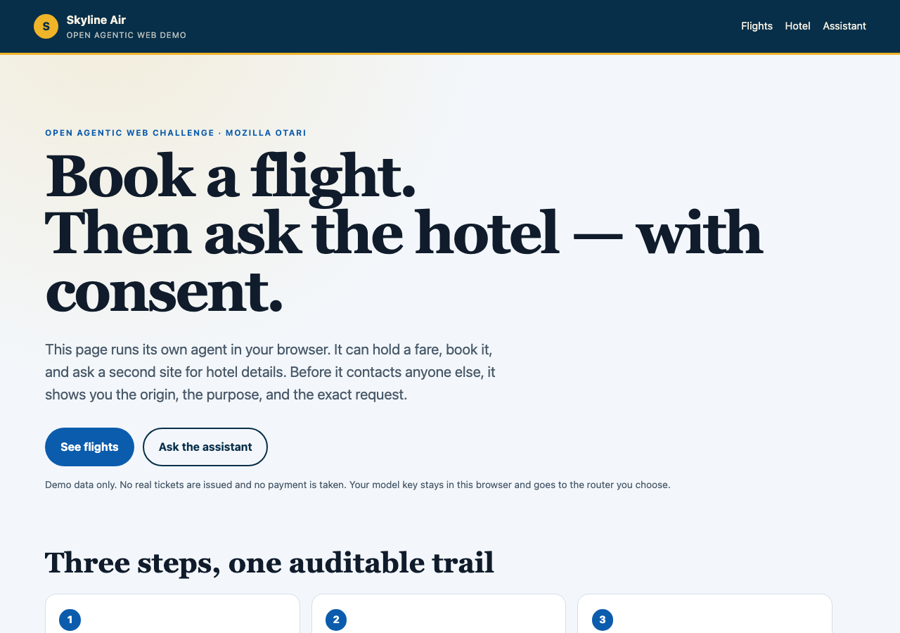
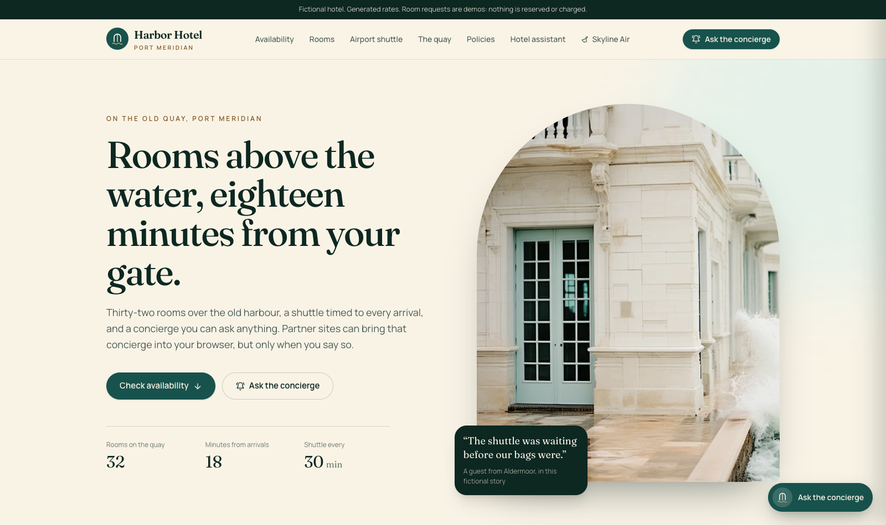
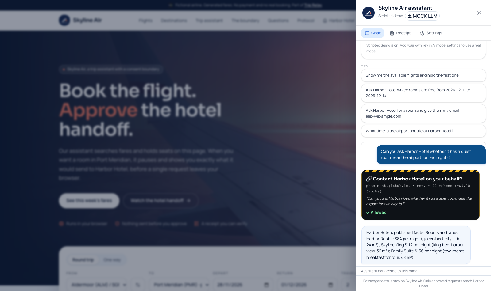

# Trip Relay

[](https://github.com/pham-canh/trip-relay/actions/workflows/test.yml)

Two travel agentic websites, one visible consent boundary.





Trip Relay is an entry for the [Open Agentic Web Challenge](https://cognizant-agenticweb.devpost.com/), built on the MVP Profile 0.2 and Mozilla's [Otari](https://otari.ai/) router. It is a working pair of static sites:

- **Skyline Air** (`127.0.0.1:8080`) is the caller. Its network has a front agent and a `fare_agent` specialist that reads flights, holds a fare, and books it after the visitor confirms.
- **Harbor Hotel** (`localhost:8081`) is a separate origin. Its assistant knows its rooms, rates, policies, airport shuttle, and room-request flow.
- The airline's assistant can hand a hotel question to the second site. **Before any request reaches the hotel origin, the visitor sees the exact origin and request and must allow it.** Nothing is fetched on page load.

The two hostnames are deliberate: `127.0.0.1` and `localhost` are different origins, so the demo exercises the real cross-origin path on one machine.

## Why this is a cross-site problem

An agent that can use other sites is useful only if the user can tell when it crosses a boundary. Trip Relay makes that boundary the product:

- The hand-off is a tool call with a natural-language request. The runtime pauses and renders a consent card naming `localhost:8081`, the purpose, and the request text.
- Declining cancels the tool call. The hotel manifest, network, and actions are never fetched.
- Allowing fetches only the hotel's public artifacts. The hotel runs in the caller's browser with the caller's router. It never receives the chat history, the page state, the passenger's email, or the API key.
- Irreversible writes stay on their owning page. Flight booking and room requests both have their own confirmation dialog and a stale-version check.



## Run it locally

Requirements: Node.js 22+ and an OpenAI-compatible model endpoint that supports tool calls. The default router is Otari's hosted endpoint.

```bash
npm test

# terminal 1
npm run serve:airline

# terminal 2
npm run serve:hotel
```

Open <http://127.0.0.1:8080/>. Click **Ask Skyline** to open the assistant drawer, go to the **Settings** tab, choose **Otari (Mozilla)** and paste a `tk-...` key, or choose another provider and enter its key and model. The key is stored in this browser and sent only to the router you choose.

The manual pages work without a key, so the demo never depends on a provider being available.

Try the cross-site path:

1. Ask: *“Can you ask Harbor Hotel for a quiet room near the airport for two nights?”*
2. The assistant calls the `harbor_hotel` tool. A consent card appears before any hotel request.
3. Press **Decline** once: the answer stops, and the hotel origin was never contacted.
4. Ask again and press **Allow**: the airline loads the hotel's manifest and network, runs it locally, and summarizes the reply.

## How it works

```
Browser tab, caller origin 127.0.0.1:8080
  index.html
    -> site.js / AssistantMount
    -> runtime boot
    -> agent-manifest.json
    -> skyline_air.network.json
    -> site-actions.js  (get_airline_state, select_flight, book_flight)
  model call -> Otari /api/v1/chat/completions
  tool "harbor_hotel"
    -> consent card (origin, purpose, exact request)
    -> fetch http://localhost:8081/agent-manifest.json
    -> fetch the hotel network + links
    -> run the peer network locally with the same router
    -> hotel answer returns as a tool result
```

| Path | What it publishes |
| --- | --- |
| `site/agent-manifest.json` | Brand, network, Otari router, `allowed_peers`, closed peer policy, actions, theme, deployment |
| `site/skyline_air.network.json` | Resolved Neuro SAN network: front agent, instructions, schemas, link to `http://localhost:8081/harbor_hotel` |
| `site/links.json` | Publisher-owned peer link map |
| `site/site-actions.js` | The three grounded page actions |
| `peer/agent-manifest.json` | The hotel's manifest, with `allowed_peers: []` |
| `peer/harbor_hotel.network.json` | The hotel network and its two actions |
| `scripts/serve.mjs` | Static server with CORS, so the hotel's public files are readable from the airline origin |

Generated discovery files are committed too: `agent-mcp.json`, `.well-known/nsdeploy*.json`, and `bridge/`.

## Safety and privacy

- **Consent precedes contact.** The browser test asserts zero requests to `localhost:8081` before **Allow**.
- **Private context by exception.** The hotel receives only the natural-language `request` field. Chat history, page state, passenger names, emails, and the key are not forwarded.
- **Closed peer policy.** The airline's manifest lists exactly one allowed peer origin; the hotel lists none.
- **No key sharing.** The hotel network is fetched as public data and executed in the caller's browser. The key goes only to the configured router.
- **Two gates for writes.** `book_flight` and `request_room` require a visitor confirmation and a current `expectedVersion`; a stale call is refused with a readable reason.
- **Demo data only.** State lives in memory, resets on reload, takes no payment, and no request is sent to a real airline or hotel.

## Tests

```bash
npm test
```

The suite runs the real runtime with a scripted model, no network:

- 8 caller tests: network validation, two-agent delegation, manifest/action agreement, read tool, flight write, confirmation gating, decline, approval, stale versions, dialog words.
- 5 peer tests: closed policy, grounded read, room-request confirmation, refusal paths, dialog words.

Thirteen tests in total.

A Playwright pass also exercised both pages in Chromium: manual flight booking and room request, the consent card, the no-contact-before-consent assertion, the approved cross-site answer, and zero console errors. See [docs/DEMO.md](docs/DEMO.md).

## Otari

Both manifests point at `https://api.otari.ai/api/v1`; the settings panel includes an **Otari (Mozilla)** preset with the challenge model `alibaba/qwen-3.5-35b-a3b`. The integration notes, the onboarding problem I hit, and the improvement I would make are in [docs/OTARI.md](docs/OTARI.md). Copy-ready Devpost fields are in [docs/DEVPOST.md](docs/DEVPOST.md).

## Deploying

The demo needs **two different origins**, not two paths on one host. GitHub Pages alone cannot provide that: `user.github.io/a` and `user.github.io/b` share an origin. Use two static hosts, or a host plus a subdomain.

1. Publish `site/` at origin A and `peer/` at origin B. Keep the CORS headers on the hotel's public files.
2. Update the hotel URL in `site/skyline_air.hocon` (`tools` and `link_labels`), `HOTEL` in `site/app.js`, and `allowed_peers` in `site/agent-manifest.json`.
3. Update the airline URL in `peer/index.html`, and the hotel's display links.
4. Regenerate the published network JSON with the [Agentify Website skill](https://github.com/cognizant-ai-labs/agentic-web) build script, then rerun `npm test`.
5. Use HTTPS. Loopback HTTP is only for local development.

## Spec mapping

The requirement-by-requirement map is in [docs/SPEC-MAPPING.md](docs/SPEC-MAPPING.md).

## Repository layout

```
site/               airline website plus generated network artifacts
peer/               hotel website plus generated network artifacts
tests/              node:test suites and the runtime stubs they use
scripts/serve.mjs   dependency-free static server with CORS
docs/               screenshots, demo script, Otari notes, spec map, Devpost copy
```

## Credits

The browser runtime in `site/runtime/` and `peer/runtime/` comes from the
[Cognizant Agentic Web `agentify-website` skill](https://github.com/cognizant-ai-labs/agentic-web)
and is licensed under Apache 2.0; its license is kept at
`site/runtime/LICENSE.txt`. The site code, networks, actions, tests, and docs are
this project's own work.

Otari is Mozilla's open-source LLM router: <https://github.com/mozilla-ai/otari>.

## License

MIT for this project's code. See [LICENSE](LICENSE). The vendored runtime keeps
its Apache 2.0 license.
