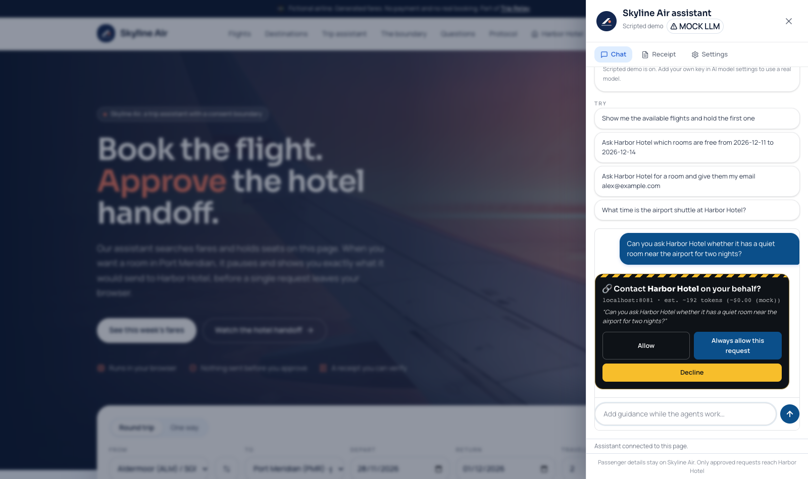
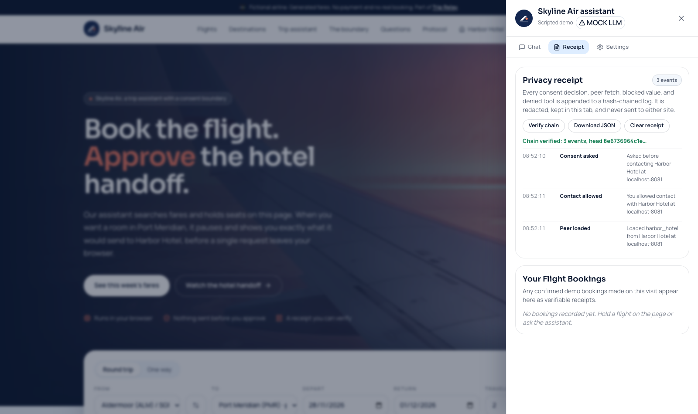

# Trip Relay

[](https://github.com/pham-canh/trip-relay/actions/workflows/test.yml)

Two agentic travel sites, one visible boundary. Zero hotel requests before you press Allow.


Trip Relay is an entry for the [Open Agentic Web Challenge](https://cognizant-agenticweb.devpost.com/), built on the MVP Profile 0.2 and Mozilla's [Otari](https://otari.ai/) router.

It is a **reference implementation of a consent-gated agent handoff**, demonstrated with a working pair of static travel sites. The airline and hotel are fictional, the inventory is generated, and no payment or real reservation is made. The contribution is the boundary, not the travel inventory: the airline is the caller, the hotel is a separate origin, and the browser pauses before the first peer request. The full pattern, threat model, and limitations are in [PROTOCOL.md](PROTOCOL.md).

**Live demo:** <https://pham-canh.github.io/trip-relay/>. The hotel is at <https://pham-canh.github.io./> — the trailing dot is part of the host. Browsers treat `pham-canh.github.io` and `pham-canh.github.io.` as different origins, so the same GitHub Pages host can serve both sides of the boundary. **Do not drop the dot:** without it the hotel is on the airline's origin. The browser evidence and the one-command deployment check are in [`docs/ORIGIN.md`](docs/ORIGIN.md). The manual pages work without a key; the cross-site assistant needs a working Otari key in the browser.

**For judges:** [`docs/JUDGE-GUIDE.md`](docs/JUDGE-GUIDE.md) is a one-page path through the demo, the two built-in signals, what is real vs scripted, BYOK, and the community tools.

**Demo video:** [the final entrant-voice cut on YouTube](https://youtu.be/lDLhXmqXv6I) (1:46) — Vietnamese narration by the entrant, with English subtitles burned into the picture and a transcript in [`docs/VIDEO-TRANSCRIPT.md`](docs/VIDEO-TRANSCRIPT.md). The [synthetic timing cut](https://youtu.be/uXQRyKOMyxQ) and [`docs/trip-relay-demo.mp4`](docs/trip-relay-demo.mp4) are demo-only; do not submit them. Both cuts were recorded against the local pair with a scripted OpenAI-compatible endpoint, so the assistant header says `⚠ MOCK LLM — no real model`; the public pair defaults to Otari. The silent cut, the Vietnamese script, and the dubbing steps are in [`docs/DUB-VI.md`](docs/DUB-VI.md).

The two sites are:

- **Skyline Air** (`127.0.0.1:8080` locally; `https://pham-canh.github.io/trip-relay/` hosted) is the caller. Its network has a front agent and a `fare_agent` specialist that reads flights, holds a fare, and books it after the visitor confirms.
- **Harbor Hotel** (`localhost:8081` locally; `https://pham-canh.github.io./` hosted) is a separate origin. Its assistant knows its rooms, rates, policies, airport shuttle, and room-request flow.
- The airline's assistant can hand a hotel question to the second site. **Before any request reaches the hotel origin, the visitor sees the exact origin and request and must allow it.** Nothing is fetched on page load.

The two hostnames are deliberate: `127.0.0.1` and `localhost` are different origins locally; the hosted pair uses the trailing-dot form of the GitHub Pages host. In both cases the demo exercises the real cross-origin path, not two paths on one origin. [`docs/ORIGIN.md`](docs/ORIGIN.md) records the browser proof and the URL to use for the hotel.

## Why this is a cross-site problem

An agent that can use other sites is useful only if the user can tell when it crosses a boundary. Trip Relay makes that boundary the product. This is the part intended to outlive the demo:

- **Consent before contact.** The runtime pauses before the first peer fetch. Declining means the hotel manifest is never requested.
- **Exact network, no fallback.** `http://localhost:8081/harbor_hotel` must match a published network name. A missing name fails closed instead of running a different network.
- **Private context by exception.** The runtime forwards the declared request, not the caller's chat history, page state, passenger record (name and email), or API key. The consent card shows the exact text that will cross.
- **Writes stay owned.** Flight booking and room requests require confirmation and a current version on the owning origin.
- **The boundary leaves a receipt.** A visitor-facing **Privacy receipt** lists every consent decision, peer fetch, peer failure, blocked value, and denied tool. It verifies the hash chain in the page and downloads the redacted log as JSON. It is stored in this tab's browser database, so it survives a reload, and it is not sent to either site; it is not a remote WORM store.
- **The boundary is testable.** The browser pass asserts zero hotel requests before **Allow**; the unit suite checks policy, the exact link, and write refusal paths.

The travel flow is the demonstration. The reusable idea is a small policy-and-consent layer that any publisher could put in front of a peer agent network.

The hand-off is a tool call with a natural-language request. The runtime pauses and renders a consent card naming the peer origin (`localhost:8081` locally; `pham-canh.github.io.` hosted), the purpose, and the request text. Declining cancels the call; **Allow** fetches only the hotel's public artifacts. The hotel runs in the caller's browser with the caller's router. The runtime forwards only the request text; it does not forward the chat history, page state, airline passenger record, or key.



## Run it locally

Requirements: Node.js 22+ and an OpenAI-compatible model endpoint that supports tool calls. The default router is Otari's hosted endpoint.

```bash
npm test

# terminal 1
npm run serve:airline

# terminal 2
npm run serve:hotel
```

Open <http://127.0.0.1:8080/> and press **Ask Skyline** to open the assistant drawer. In its **Settings** tab, choose **Otari (Mozilla)** and paste an `otk_...` key, or choose another provider and enter its key and model. Global Otari keys use `https://api.otari.ai/api/v1`; EU keys start with `otk_v1_eu_` and use `https://eu.api.otari.ai/api/v1`. The preset detects the EU prefix and fills the right router. The key is stored in this browser and sent only to the router you choose.

The manual pages work without a key, so the demo never depends on a provider being available. For the assistant without a key, open **Ask Skyline** and press **Try the scripted demo (no key)**. It uses the deterministic `browser://mock` router: one read or peer call, a real consent card, and a real Privacy receipt, with no provider request and no write. A live model call is the only part that needs Otari or another OpenAI-compatible endpoint.

### Five-minute review

1. `npm test` — 35 unit checks, no network; then `npm run benchmark:dlp` for the hostile-peer matrix.
2. Start both servers, open <http://127.0.0.1:8080/>, and book a flight manually.
3. Read the handoff sequence in [PROTOCOL.md](PROTOCOL.md), then run the cross-site question below.
4. Inspect the consent card, the **Receipt** tab, and the spec map.
5. The browser pass in `docs/DEMO.md` is the reproducible version of the consent check; the receipt is described below.

Try the cross-site path:

1. Ask: *“Can you ask Harbor Hotel for a quiet room near the airport for two nights?”*
2. The assistant calls the `harbor_hotel` tool. A consent card appears before any hotel request.
3. Press **Decline** once: the answer stops, and the hotel origin was never contacted.
4. Ask again and press **Allow**: the airline loads the hotel's manifest and network, runs it locally, and summarizes the reply.

## Privacy receipt

In the assistant drawer, the **Receipt** tab reads the same hash-chained audit log the runtime writes. It lists the consent request, the decision, the peer fetch, a peer failure, any DLP block, and any denied tool. **Verify chain** recomputes every hash in the page; **Download JSON** exports the redacted log; **Clear receipt** starts a fresh chain. The log is stored in this tab's IndexedDB and survives a reload. A stored chain that fails verification is refused and never loaded into the live log. It is never sent to either site and is not a remote WORM store.



## How it works

The sequence below is the short version. [PROTOCOL.md](PROTOCOL.md) names the actors, artifacts, policy gates, failure modes, and the invariants the tests assert.

```
Browser tab, caller origin 127.0.0.1:8080
  index.html
    -> site.js / AssistantMount
    -> runtime boot
    -> agent-manifest.json
    -> skyline_air.network.json
    -> site-actions.js  (get_airline_state, select_flight, book_flight)
  model call -> Otari /api/v1/chat/completions
  tool "harbor_hotel"
    -> consent card (origin, purpose, exact request)
    -> fetch http://localhost:8081/agent-manifest.json
    -> fetch the hotel network + links
    -> run the peer network locally with the same router
    -> hotel answer returns as a tool result
```

| Path | What it publishes |
| --- | --- |
| `site/agent-manifest.json` | Brand, network, Otari router, `allowed_peers`, closed peer policy, actions, theme, deployment |
| `site/skyline_air.network.json` | Resolved Neuro SAN network: front agent, instructions, schemas, link to `http://localhost:8081/harbor_hotel` |
| `site/links.json` | Publisher-owned peer link map |
| `site/site-actions.js` | The three grounded page actions |
| `peer/agent-manifest.json` | The hotel's manifest, with `allowed_peers: []` |
| `peer/harbor_hotel.network.json` | The hotel network and its two actions |
| `scripts/serve.mjs` | Static server with CORS, so the hotel's public files are readable from the airline origin |

Generated discovery files are committed too: `agent-mcp.json`, `.well-known/nsdeploy*.json`, and `bridge/`.

## Safety and privacy

- **Consent precedes contact.** The browser test asserts zero requests to `localhost:8081` before **Allow**.
- **Private context by exception.** For the peer answer, the hotel receives only the natural-language `request` field. Chat history, page state, the airline passenger's name/email, and the key are not forwarded. A hotel room request is a separate action owned by the hotel and confirmed there.
- **Closed peer policy.** The airline's manifest lists exactly one allowed peer origin; the hotel lists none.
- **No key sharing.** The hotel network is fetched as public data and executed in the caller's browser. The key goes only to the configured router.
- **Two gates for writes.** `book_flight` and `request_room` require a visitor confirmation and a current `expectedVersion`; a stale call is refused with a readable reason.
- **Demo data only.** State lives in memory, resets on reload, takes no payment, and no request is sent to a real airline or hotel.
- **Measured adversarial hardening.** `npm run benchmark:dlp` runs 12 hostile-peer cases and 4 controls against the real dispatch boundary with a per-run canary. The current result is 12/12 attacks blocked, 0 canary egress, 0 unauthorized writes, and 4/4 controls pass ([committed report](docs/dlp-benchmark.json)). The browser pass also drives a hostile peer fixture through the real page: an email in the outbound request is blocked before consent and fetch, and an API key in the inbound reply is blocked before rendering. The audit log is a per-tab hash chain persisted in IndexedDB, not a remote WORM store; the scope and remaining work are in [`docs/ROADMAP-DLP.md`](docs/ROADMAP-DLP.md).

## Community tools

The boundary ships as reusable tooling, not only as a demo:

- [`scripts/check_origins.mjs`](scripts/check_origins.mjs) — dependency-free check that a two-site pair is on distinct origins, both manifests load, the peer manifest is CORS-readable, and the caller's `allowed_peers` matches. `npm run check:origins`.
- [`scripts/benchmark_dlp.mjs`](scripts/benchmark_dlp.mjs) — deterministic 12-attack / 4-control matrix against the real dispatch boundary, with a per-run canary. `npm run benchmark:dlp`.
- [`scripts/browser_check.mjs`](scripts/browser_check.mjs) — 67-check Playwright pass covering consent ordering, receipt verify/download/reload/clear, hostile peer, mobile, keyboard, and the keyless demo. `npm run check:browser`; the hosted variants are `check:browser:live` (13) and `check:browser:demo` (10).
- [`PROTOCOL.md`](PROTOCOL.md) — the pattern, threat model, failure modes, and limits.
- [`docs/SPEC-MAPPING.md`](docs/SPEC-MAPPING.md) — requirement-by-requirement map to MVP Profile 0.2.
- [`docs/COMMUNITY.md`](docs/COMMUNITY.md) — what another team should copy, what to change, and what not to copy.

The pair is listed on the challenge's official [agentic websites list](https://github.com/cognizant-ai-labs/agentic-web/blob/main/docs/agentic_websites.md) (PR #85, merged).

## Tests

```bash
npm test
npm run benchmark:dlp
npm run check:origins
```

The unit suite runs the real runtime with a scripted model, no network:

- 9 caller tests: network validation, two-agent delegation, manifest/action agreement, read tool, flight write, confirmation gating, decline, approval, stale versions, dialog words, and Otari regional-router selection.
- 5 peer tests: closed policy, grounded read, room-request confirmation, refusal paths, dialog words.
- 13 DLP/audit tests: canary normalization, peer/tool/sly_data/response blocks, consent binding, tool denial, closed peer policy, audit redaction and tamper detection.
- 3 receipt-chain tests: restore a stored chain, refuse a tampered store, and clear to a fresh chain.
- 5 keyless-demo tests: select `browser://mock` without a key, route a hotel question to the peer, refuse a write, summarize hotel facts, and report a blocked or failed tool without retrying.

Thirty-five tests in total. The browser pass is committed too; with the local pair running, `npm run check:browser` runs 67 checks. Against the deployed pair, `npm run check:browser:live` runs 13 consent/receipt checks and `npm run check:browser:demo` runs 10 keyless-demo checks. All use a scripted endpoint and need Chrome plus `npm install`.

| Check | Result | What it covers |
| --- | --- | --- |
| Unit suite | 35/35 | network validation, delegation, manifest/action agreement, writes, consent, decline/allow, stale versions, Otari region selection, DLP, audit restore/tamper/clear, keyless demo |
| DLP benchmark | 12/12 attacks, 4/4 controls | per-run canary, encoded/zero-width/base64 egress, peer response, coded-tool args, sly_data, secrets, caller-write denial, closed policy, audit tamper; clean hotel/coded flows, decline, audit redaction |
| Local browser pass | 67 checks | 18 page/receipt checks, 13 consent checks, 4 peer-failure checks, 12 hostile-peer DLP checks, 10 mobile/a11y checks, and 10 keyless-demo checks: both pages, the four-room hotel page, manual booking, receipt verify/download/reload/clear, zero hotel requests before **Allow**, approved cross-site answer, blocked outbound email, blocked inbound key, peer 503, phone layout, keyboard consent, the visible mock label, and no provider call in the demo |
| Hosted browser pass | 13 checks | the same consent flow against the deployed pair after the redesign, including the trailing-dot hotel origin: 0 before **Allow**, 0 after **Decline**, 11 after **Allow**, receipt chain verifies, zero console errors |
| Hosted demo pass | 10 checks | `npm run check:browser:demo`: the deployed keyless demo boots without a key, calls no provider, returns the hotel facts, writes and verifies the receipt, and exits back to the key requirement |
| Hosted origins + CORS | pass | `npm run check:origins`: distinct origins, hotel manifest and network readable, closed peer policy |
| Live Otari call | not yet recorded | add a key in the assistant drawer's **Settings** tab and repeat the question; see [`docs/SUBMIT.md`](docs/SUBMIT.md) |

The unit and browser passes use a scripted model that speaks the same SSE/tool-call protocol. They prove the boundary and the consent flow; they are **not** a live Otari call. The public manifests default to Otari, and the repository contains no key. The hosted evidence, including the two `location.origin` values and the `localStorage` isolation probe, is in [`docs/ORIGIN.md`](docs/ORIGIN.md). GitHub Actions also has a manual **origin-check** workflow (**Actions → origin-check → Run workflow**) that runs `npm run check:origins` against the live pair.

## Otari

Both manifests publish `https://api.otari.ai/api/v1` as the default; the settings panel includes **Otari (Mozilla)** for global keys and **Otari (Mozilla, EU)** for keys that start with `otk_v1_eu_`, both with the challenge model `alibaba/qwen-3.5-35b-a3b`. The EU preset exists because a key sent to the wrong regional host returns HTTP 421 and names the host it belongs to. The integration notes, the onboarding problems I hit, and the improvement I would make are in [docs/OTARI.md](docs/OTARI.md). Copy-ready Devpost fields are in [docs/DEVPOST.md](docs/DEVPOST.md).

The unit and browser checks use a scripted model. A live Otari answer is a manual step after adding a key; the repository does not contain one.

## Deploying

The public pair is live:

- Airline: <https://pham-canh.github.io/trip-relay/>
- Hotel: <https://pham-canh.github.io./>

The hotel uses the trailing-dot form of the same GitHub Pages host. That is a real, distinct browser origin, not a path trick: `pham-canh.github.io` and `pham-canh.github.io.` have different origins, and GitHub Pages serves both with `Access-Control-Allow-Origin: *`. It avoids requiring a second owner or a custom domain. The airline is the `gh-pages` branch of `pham-canh/trip-relay`; the hotel is the `main` branch of the user Pages repo `pham-canh/pham-canh.github.io`. Some corporate proxies and VPNs reject trailing-dot hosts; the airline's hotel link is the tested path, and the local pair remains the fallback. A custom domain is the cleaner long-term option and only requires changing `PEER_URL`. The browser proof and the caveat are in [`docs/ORIGIN.md`](docs/ORIGIN.md).

`npm run build:pages` copies `site/` and `peer/` into `dist-pages/airline` and `dist-pages/peer` and rewrites the local URLs. Override `AIRLINE_URL` and `PEER_URL` to target another host:

```bash
AIRLINE_URL=https://airline.example/ PEER_URL=https://hotel.example/ npm run build:pages
```

The generated directories are gitignored; publish each one at its origin root. The build fails if both URLs share an origin. Keep CORS on the hotel's public files. Use HTTPS except for loopback development. After any URL change, rebuild the published network JSON if you edited the HOCON, run `npm test`, run `npm run check:origins`, and repeat the cross-origin browser check.

The pair is listed on the challenge's official [agentic websites list](https://github.com/cognizant-ai-labs/agentic-web/blob/main/docs/agentic_websites.md) ([PR #85](https://github.com/cognizant-ai-labs/agentic-web/pull/85), merged).

## Spec mapping

The requirement-by-requirement map is in [docs/SPEC-MAPPING.md](docs/SPEC-MAPPING.md).

## Repository layout

```
site/               airline website plus generated network artifacts
peer/               hotel website plus generated network artifacts
tests/              node:test suites and the runtime stubs they use
scripts/serve.mjs   dependency-free static server with CORS
scripts/build_public.mjs  two-origin public build with URL rewriting
docs/               screenshots, demo script, origin proof, Otari notes, spec map, Devpost copy
PROTOCOL.md         the consent-gated handoff pattern, failure modes, and limitations
```

## Credits

The browser runtime in `site/runtime/` and `peer/runtime/` comes from the
[Cognizant Agentic Web `agentify-website` skill](https://github.com/cognizant-ai-labs/agentic-web)
and is licensed under Apache 2.0; its license is kept at
`site/runtime/LICENSE.txt`. The site code, networks, actions, tests, and docs are
this project's own work. **Lolo (Euloge)** designed the Skyline Air and Harbor
Hotel interface, the assistant drawer, and the design QA pass.

Otari is Mozilla's open-source LLM router: <https://github.com/mozilla-ai/otari>.

## License

MIT for this project's code. See [LICENSE](LICENSE). The vendored runtime keeps
its Apache 2.0 license.
